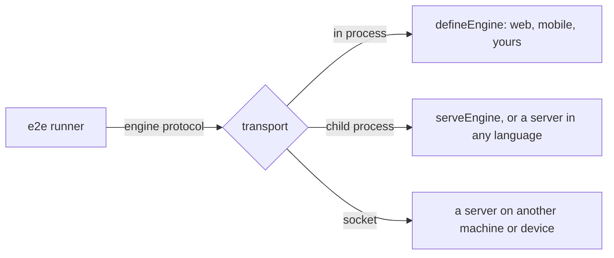

An engine drives a user interface, such as a browser, a simulator, or a TV,
for `screen`, `app`, and the agent. The runner drives every engine over the
[engine protocol](/reference/engine-protocol): JSON-RPC messages, one per
engine member. `@e2e-dev/web` and `@e2e-dev/mobile` are engines too.

## Choose how to write one

| You want | Write | Guide |
| --- | --- | --- |
| An engine in TypeScript | `defineEngine`, set on a target | [Writing an engine](/writing-an-engine) |
| A TypeScript engine in its own process | `defineEngine`, served with `serveEngine` | [Engine servers](/engine-servers#serve-a-typescript-engine) |
| An engine in another language, or on a device | A server that answers the protocol's messages | [Engine servers](/engine-servers#write-a-server-in-another-language) |

An engine from `defineEngine` runs in the runner's process. Every call still
crosses the protocol, so an engine that passes its suite needs nothing a
server elsewhere couldn't receive.

## Next

<CardGroup cols={2}>
  <Card title="Writing an engine" icon="code" href="/writing-an-engine">
    Build an engine with `defineEngine`, step by step.
  </Card>
  <Card title="Engine servers" icon="network-wired" href="/engine-servers">
    Run an engine in another process, machine, or language.
  </Card>
  <Card title="e2e/engine" icon="book" href="/reference/engine">
    Every type and hook of the engine contract.
  </Card>
  <Card title="Engine protocol" icon="book" href="/reference/engine-protocol">
    Every message, as a server receives it.
  </Card>
</CardGroup>
