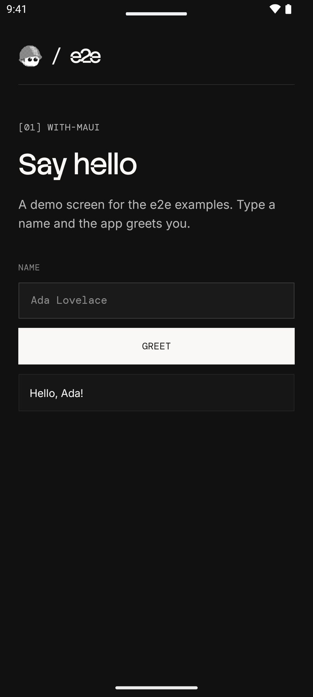
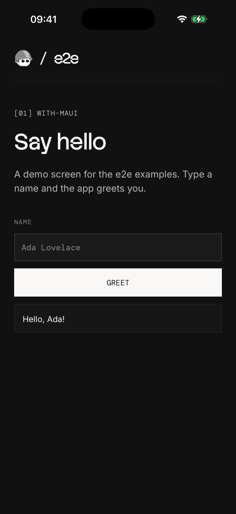

# e2e with .NET MAUI

A .NET MAUI greeting app with three locator tests and two agent tests per
platform. Android and iOS share one page, `MainPage.xaml`. The test project
is in `e2e/`, next to the .NET project.

 

## Run

Install the [.NET 10 SDK](https://dotnet.microsoft.com/download) and the
MAUI workload with `dotnet workload install maui`, or `maui-android` on
Linux, where the project builds for Android only. Add the Android SDK with
an emulator, Xcode with an iOS simulator, or both. Start an emulator or
simulator, then build and install the app from this folder:

| Platform | Build and install |
| --- | --- |
| Android | `dotnet build -t:Install -f net10.0-android` |
| iOS | `dotnet build -f net10.0-ios -p:RuntimeIdentifier=iossimulator-arm64`, then `xcrun simctl install booted bin/Debug/net10.0-ios/iossimulator-arm64/WithMaui.app` |

With more than one Android device running, add
`-p:AdbTarget="-s <serial>"`; `adb devices` lists the serials. On an Intel
Mac, use `iossimulator-x64`.

Use Node 22.22.3+, 24.8+, or 26+ for the tests. From this folder:

```bash
cd e2e
npm install
npx agent-device doctor
npm run test:e2e:android   # or test:e2e:ios
```

After app changes, build and install again before you run the tests.

## Agent tests

Set a [Vercel AI Gateway](https://vercel.com/docs/ai-gateway) key.
From `e2e/`:

```bash
AI_GATEWAY_API_KEY="your-key" npm run test:e2e:android
```

Without the key, the agent tests skip. Add `-- --no-cache` to use fresh
model calls. Results are in `e2e/.e2e/report.json`.

## Notes for MAUI apps

- `getByTestId` finds an `AutomationId`: the accessibility identifier on
  iOS. On Android, MAUI writes it as the resource id
  `dev.e2e.examples.maui:id/<AutomationId>`, and `getByTestId('greet')`
  finds it without the package.
- The placeholder is not a name. iOS takes the field's name from
  `SemanticProperties.Description`. On Android, MAUI also writes the
  description into the field's text, so a filled field reads `Name, Ada`.
  [MainPage.xaml](MainPage.xaml) sets it on iOS only.
- A Debug build for Android keeps its assemblies outside the APK (Fast
  Deployment), and `app.clearState()` deletes them with the app data. The
  app then exits at start. For tests that clear app data, build with
  `-p:EmbedAssembliesIntoApk=true`.

See [e2e/e2e.config.ts](e2e/e2e.config.ts) and [e2e/tests/](e2e/tests/) for the setup.
For device setup and CI, see the [Mobile guide](https://e2e.tester.army/docs/mobile).

The bundled fonts use the [SIL Open Font License](Resources/Fonts/OFL.txt).

Last checked on 2026-10-17 with e2e 0.21.2, @e2e-dev/mobile 0.12.3, .NET
SDK 10.0.201, and MAUI 10.0.20 on an Android 15 emulator and an iOS 26.4
simulator. Three locator tests passed on each; the agent tests skipped
without a key.
